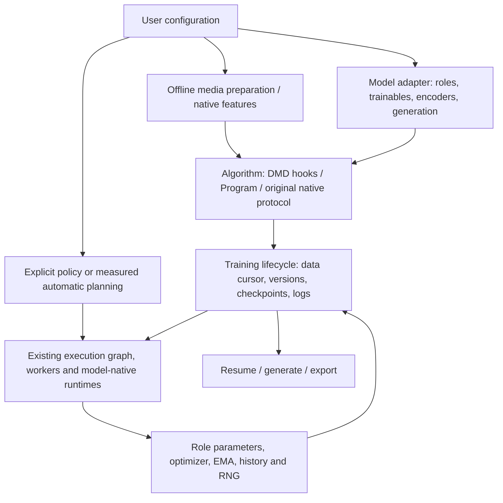

# DMD-System framework architecture

DMD-System separates **training mathematics**, **state ownership** and **physical
execution**. A model does not select its own devices. A planner does not replace
the loss or invent model calls. A trainer advances actual state and data rather
than replaying independent initialized trials.

## Existing abstractions remain the owners

| Concern | Public seam | Execution ownership |
| --- | --- | --- |
| Models | `training.ModelComponents` returned by a trusted model factory | Named modules, optimizers and optional scheduler/EMA/history state; model-owned encode/generate/decode/export functions |
| Data | `data.PreparedDataset`, independent `InputStreams`, model-native offline preparers | Exact tensor trees, sample IDs, hashes, original conditioning and ordered cursor |
| Algorithm | Existing `DMDHooks`, `Program`, `Call`, or a native recipe | Actual loss, sample policy, G/C update order, EMA and history semantics |
| Lifecycle | `training.session` and complete-cycle checkpoint API | Persistent owned training state, data progress, metrics and recovery |
| Placement and state policy | Existing `ExecutionPlan`, capabilities, calibration and search | Only admitted Resident/FSDP2/HSDP/ZeRO-3/role-pool paths; backend support is explicit |
| Physical work | Existing `StaticRoleRunner`, `ExecutionBackend`, native workers | Actual selected calls, version dependencies and backend-specific communication |
| Historical reproduction | Frozen catalogs, profiles and source maps | Original source, asset, capacity and numerical admission |

`DMDModelAdapter` remains the original typed-plan/native invocation interface.
`ModelComponents` supplies the model state for the existing open Program ABI;
it does not replace that adapter or create another graph/solver. The existing
`ExecutionBackend` and original native workers own backend-specific
initialization and distributed operations. The unused future-only `TrainingBackend`/`BackendState` stub has been removed;
use the live lifecycle and backend interfaces above instead.

## Continuous training and paired trials

The open runtime's original default clones state and feeds together for each
calibration/reference trial. This preserves optimizer Parameter ownership and
keeps trials independent. Public Program training explicitly transfers ownership
of its persistent state into one-cycle sessions; it does not deep-copy models
and optimizer tensors on each update.

The algorithm factory returns one real cycle, keeping the existing 511-call
Program bound independent of total training duration. Between cycles the
trainer advances logical versions and the ordered sample cursor. It checks the
same call structure, model/precision, bindings and capability admission before
reusing an execution policy. No mid-cycle restart or unresolved data-dependent
graph is inferred.

## Planning remains optional and executable

`reference` uses the existing resident reference implementation; `manual`
supplies an admitted implementation and optional legal order. `auto` uses the
existing measured calibration and constrained search, then performs the existing
full reference/selected-state gate. `plan` consumes a serialized selection with
the original source/state/input/cost validation.

After initial admission, a saved cycle policy binds the measured implementation
and legal call order to subsequent data and advancing state versions. This is
explicitly a **training continuation**, not a claim that later parameters or
sample values equal the original calibration snapshot. The runtime records the
selected implementation, plan hash, actual executed operations and final
versions. It never falls back to a named historical winner.

Generic persistent Program training owns one device per process and uses the
existing allocated distributed Program interface when an explicit torchrun
group is supplied. Resident/DDP/FSDP2/HSDP layouts persist across cycles;
same-topology restart restores local shards into the same live parameter
objects. Role-pool interfaces retain their separate admission. Six native recipes preserve their
original distributed contracts. W1/W2/W4/W5 add explicitly versioned fresh-input,
original-engine continuation; selected benchmark bindings remain bounded.
These paths reuse the same complete-cycle checkpoint/state machinery, not
another DMD loop or solver. See the
[support matrix](../guides/support_matrix.md); source/CPU integration does not
constitute new CUDA validation.

## Source and package organization

Public configuration and metadata discovery import no model libraries. Optional
training/media/backend dependencies are installed in a user-chosen environment.
The common Program backend and packaged example work in a wheel outside the
checkout. Native original-model recipes require the source checkout and their
explicit compatible upstream assets.

`recipes/` contains requests and guides, `examples/` contains extension samples,
and `tools/`/`benchmarks/` contain developer experiments. Audited root `runtime/`
mechanisms keep their existing import paths. Historical source maps and evidence
are retained; reviewed source updates have an explicit lock entry.

## Design references

The separation of public interfaces, model implementations and infrastructure
is informed by [ReaLHF's architecture](https://openpsi-project.github.io/ReaLHF/arch).
The distinction between algorithm control and distributed computation follows
the [HybridFlow programming guide](https://verl.readthedocs.io/en/latest/hybrid_flow.html).
These are structural references, not new runtime dependencies or claims that
DMD-System implements every capability of either project. DMD-System's
state/version graph and DMD-specific retained-state capabilities remain its own
interfaces; Ray is not a required dependency.

## Model, workflow and physical strategy are independent axes

The lazy model/algorithm catalogs and installed-package entry points select
factories, not hardware winners. `PredictionSpec` and effective model
capabilities are source/checkpoint-bound; epsilon, velocity, flow and x0 cannot
be swapped merely because shapes match. The generic No-GAN flow protocol is
reused by actual LTX and an independent non-LTX model. Official SD DMD2 and
Self-Forcing retain their own numerical native owners and native iteration
clocks instead of adopting that generic policy.

A native optimizer-containing macrocall remains atomic and not replay-safe.
Optional finite owner execution descriptors let the existing measured
candidate library scope a real implementation inside it, without another
solver or a model-name branch. The first implementation is actual DMD2 UNet
checkpointing. Its effects, source and restored flag lifetime are observable;
its paired reference and restart gates do not make the owner generically
shardable. Catalog discovery itself enables no optimization.
