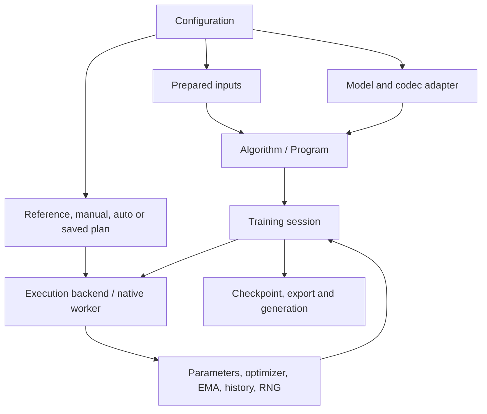

# Architecture

DMD-System separates the model, distillation algorithm, training state and
execution strategy. The user-facing command is `distillctl`; the Python package
is `distillschedule`.

## Code ownership

| Concern | Main interface | Responsibility |
| --- | --- | --- |
| Model | `training.ModelComponents` and model factories | Role modules, trainable parameters, prediction convention, codecs and export |
| Data | `data.PreparedDataset` and `InputStreams` | Prepared tensors, sample identity and stream progress |
| Algorithm | `DMDHooks`, `Program`, `Call`, or a native workflow | Loss, sampling, role updates, EMA schedule and dependencies |
| Training state | `training.session` and checkpoint APIs | Persistent state, metrics, complete-cycle save and recovery |
| Strategy | `ExecutionPlan`, capabilities, calibration and `search/` | Placement, state lifetime and legal execution order |
| Execution | `ExecutionBackend`, `StaticRoleRunner` and native workers | Device initialization, model calls and communication |

`DMDModelAdapter` is the typed native-invocation interface; `ModelComponents`
provides state to the public training lifecycle. Model-specific work belongs in
these adapters or factories rather than model-name branches in the generic solver.
A model's prediction convention (epsilon, velocity, flow or x0) must match its
algorithm. Official DMD2 and Self-Forcing retain their native update rules; the
common flow-DMD workflow is reused by the corresponding image/video/AV adapters.

## One cycle, persistent state

A Program describes one update cycle. Training retains parameters and optimizer
objects across cycles, advancing versions and data cursors. The 511-call Program
bound applies to a cycle, not the total training duration.

Calibration trials instead clone state and inputs together to isolate each
candidate and preserve optimizer-to-parameter references. After selection,
continuation uses new data and evolving parameters with the same validated
execution structure.

Checkpoints include role state, optimizer/scheduler/EMA, RNG and data progress.
Recovery is supported at complete-cycle boundaries with the same topology;
partial updates and arbitrary topology migration are not resumable checkpoints.
See [training and recovery](../guides/training.md).

## Execution strategies

`reference` selects the workflow's reference path. `manual` selects an explicit
supported implementation. `auto` measures candidates, searches feasible plans
and checks the selected result. `plan` executes a saved selection after checking
its source, state, input and cost identities. Support varies by model/backend;
see the [support matrix](../guides/support_matrix.md).

Generic Program training uses one device per process and explicit distributed
groups. Resident/DDP/FSDP2/HSDP state persists across cycles. Role pools and native
recipes have their own supported layouts and synchronization requirements.
Benchmark presets may be limited to two cycles; continuation recipes are separate.

A native call that contains an optimizer update is atomic and cannot be replayed
as a pure forward. Model-specific execution descriptors expose compatible
optimizations, such as DMD2 UNet checkpointing, without making the entire owner
generically shardable. Runtime records track the selected implementation and
executed effects; catalog discovery alone does not enable an optimization.

## Source layout

`training/` owns the public lifecycle, `open_workload/` owns Program execution,
and `search/` owns physical selection. `adapters/` and model-native workers keep
model-specific behavior. Top-level `runtime/` contains shared compatibility
components still used by current paths; the package's internal `runtime/` holds
framework execution policies. Check imports before moving either namespace.

`recipes/` contains user configurations, `examples/` extension samples, and
`tools/` and `benchmarks/` developer utilities. Metadata discovery stays lightweight
and imports no model libraries. Some native recipes need an external pinned
source tree or the source checkout; the common Program lifecycle also works
from an installed wheel. The [installation guide](../guides/installation.md)
describes the dependency groups and packaging boundaries.

Historical source maps and measurement receipts are kept for reproduction.
Changes to source-locked paths use the documented source-layout update procedure;
current guides link historical results rather than rewriting them as new tests.

## Design references

[ReaLHF](https://openpsi-project.github.io/ReaLHF/arch) and
[HybridFlow](https://verl.readthedocs.io/en/latest/hybrid_flow.html) are references
for separating model implementations, algorithm control and distributed execution.
They are not runtime dependencies. See [extensions](../guides/extensions.md) for
DMD-System's own model, workflow and capability interfaces.
