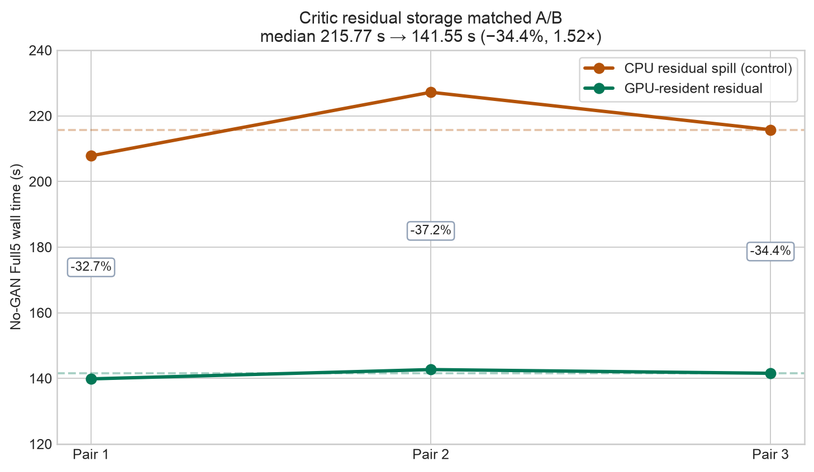
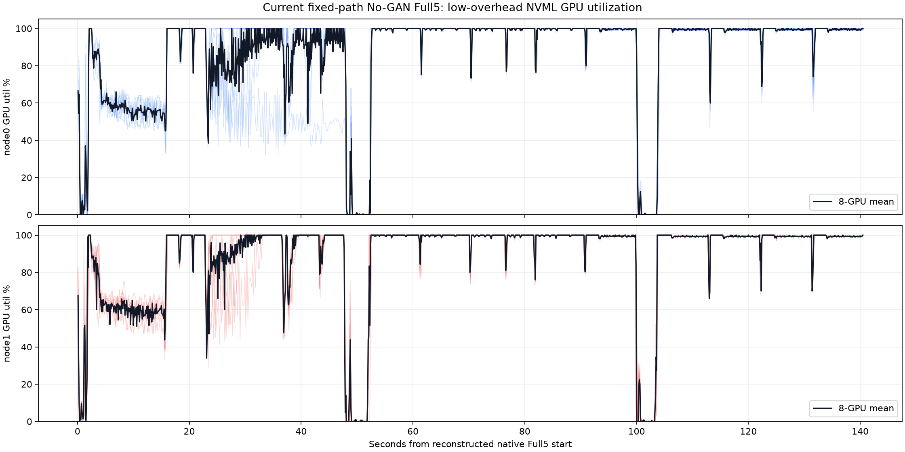
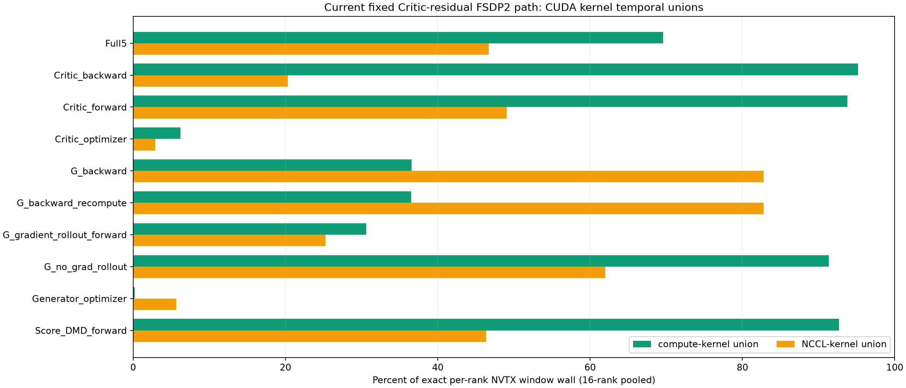

# FSDP2 Critic residual fix and current-path kernel share

This evidence bundle records the matched No-GAN world16 result after removing
the custom Critic residual CPU spill, followed by low-overhead native telemetry
and an exact Nsight CUDA-kernel temporal-union analysis of the fixed path.

## Frozen workload

The compared runs use the same measured contract:

```text
variant                 No-GAN Full5
hardware                16 x A100 40 GB
mesh                    world16 FSDP2 FULL_SHARD
rollout batch           B1
Score packing           off
updates                 G1 / C5 / EMA5
final versions          G3 / C15 / EMA15
parameter offload       false
parameter streaming     false
model swaps             0
```

The only matched A/B policy change is the Critic chunked residual storage:

```text
control      cpu_inplace
experiment   cuda_out_of_place
```

Generator residual storage remains on its frozen control policy.

## Root cause

The old Critic path in
`helios/modules/transformer_helios.py::_TembAwareChunkedResidual` synchronously
copied a BF16 residual with shape `[1, 11040, 5120]` and size
`113,049,600 B` to pageable CPU memory, then reloaded it for backward. This
was custom autograd staging, not an FSDP2 parameter offload.

The fixed policy preserves the same chunked modulation math but retains that
Critic residual on CUDA. The bounded one-Critic profile observed zero copies
of the target size in either direction on both nodes.

## Correctness and capacity gates

- Focused tests: **27 passed**.
- Both policies: **16/16 ranks PASS**.
- All six formal timing runs: **G3/C15/EMA15**, claimable timing.
- No new CPU or CUDA OOM.
- Max allocated HBM: **14.385 -> 14.490 GiB** (+107.8 MiB).
- Max reserved HBM: **25.350 GiB** for both policies.

## Matched unprofiled Full5 result

| Pair | CPU spill control | GPU resident | Saved | Reduction | Speedup |
|---:|---:|---:|---:|---:|---:|
| 1 | 207.825 s | 139.847 s | 67.979 s | 32.71% | 1.486x |
| 2 | 227.197 s | 142.677 s | 84.520 s | 37.20% | 1.592x |
| 3 | 215.769 s | 141.546 s | 74.222 s | 34.40% | 1.524x |

**Median: 215.769 s -> 141.546 s; 74.222 s saved, 34.40% lower wall,
1.524x speedup.**



The earlier 16.97 s value was the summed D2H-only copy-engine activity, not an
end-to-end critical-path bound. The synchronous pageable path also induced
backward H2D reloads and host/launch serialization.

## Current-path native telemetry

An additional unprofiled fixed-path Full5 completed in **141.411 s**. Near
100 ms NVML sampling across all 16 GPUs reported:

| Metric | Value |
|---|---:|
| Mean NVML GPU utilization | 86.84% |
| Non-zero sample fraction | 94.87% |
| Samples at or above 90% | 76.50% |
| Mean power | 295.99 W |
| Peak observed memory | 26,844 MiB |



NVML GPU utilization is a device-busy sample and is not the same metric as the
Nsight compute-kernel temporal union below.

## Current-path Nsight kernel share

The exact denominator is the per-rank
`STATIC_FSDP2_P0_FULL5` NVTX wall, pooled across 16 ranks. The median rank
wall is **143.950 s**. It deliberately does not use the **339.152 s** profile
receipt timer, which includes profiler stop/finalization and is diagnostic
only.

| Scope | Compute-kernel union | NCCL-kernel union |
|---|---:|---:|
| Full5 pooled | **69.60%** | **46.68%** |
| Rank median | **69.50%** | **47.85%** |

Compute and NCCL kernels can overlap across CUDA streams, so the two columns
are non-additive.

| Phase | Rank-wall median | Compute union | NCCL union |
|---|---:|---:|---:|
| Critic backward | 32.637 s | 95.19% | 20.31% |
| Critic forward | 12.710 s | 93.78% | 49.07% |
| Score/DMD forward | 7.362 s | 92.70% | 46.33% |
| G no-grad rollout | 38.660 s | 91.31% | 62.01% |
| G backward | 27.469 s | 36.53% | 82.79% |
| G gradient rollout forward | 14.479 s | 30.62% | 25.27% |
| Critic optimizer | 3.842 s | 6.19% | 2.91% |
| Generator optimizer | 4.305 s | 0.19% | 5.65% |



Forward/rollout stages still use FSDP2 parameter all-gathers. Their high
compute temporal coverage does not mean communication is absent: for example,
G no-grad rollout has 91.31% compute union and 62.01% NCCL union, proving
substantial cross-stream overlap. A compute union also means only that at
least one non-NCCL CUDA kernel is active; it is not SM or Tensor Core
utilization.

The clearest remaining low-coverage region is G gradient rollout forward.
This evidence does not yet turn its uncovered wall into a speedup claim:
CPU/synchronization/launch gaps and exposed collective intervals require
separate attribution, followed by a matched no-Nsight A/B for any change.

## Included evidence

- `data/iteration_303_matched_ab.json`: correctness, capacity, run identity,
  and six-run matched A/B result.
- `data/iteration_304_kernel_share.json`: combined 16-rank exact kernel
  temporal unions.
- `data/iteration_304_kernel_share_node{0,1}.json`: node-level exact windows.
- `data/iteration_304_native_telemetry.json`: pooled and per-GPU native NVML
  samples.
- `analysis/`: read-only SQLite analyzer and report builder used for the
  current-path kernel-share result.
- `ITERATION_304_PREFLIGHT.md`: pinned code/runtime/workload contract.
- `SHA256SUMS`: checksums for the complete bundle.

## Claim boundary

- The 1.524x result comes only from six matched, unprofiled Full5 runs.
- Nsight latency is diagnostic and is not substituted for native timing.
- Compute and NCCL temporal unions overlap and cannot be added.
- Temporal kernel coverage is not SM occupancy, Tensor Core utilization, or
  achieved FLOP/s.
- The result applies only to the pinned No-GAN world16 FSDP2 B1,
  Score-packing-off contract.
