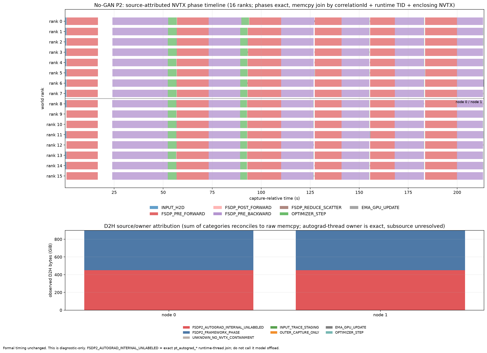
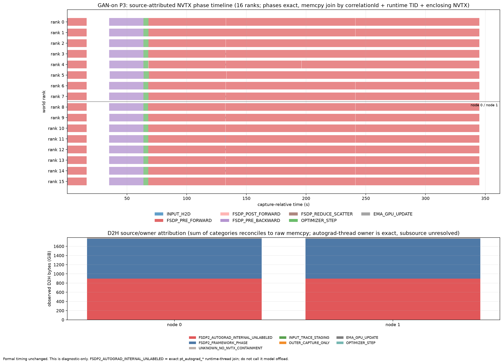

# Static FSDP2 Full5 latency and Nsight evidence

This bundle records the completed world16 static-FSDP2 baseline measurements
for PR #13. It contains the formal unprofiled latency trials, two diagnostic
Nsight timelines, and the exact SQLite-based attribution of the observed CUDA
copies.

## Configuration and correctness

Both 14B physical backbones remain FSDP2 `FULL_SHARD` across all 16 A100 40 GB
GPUs for the full measured window. The implementation uses
`reshard_after_forward=True`, so a block is transiently materialized for its
forward/backward work and then resharded. The measured workload has:

```text
model swaps            = 0
role/parameter transition = 0
parameter offload      = false
activation offload     = false
process-group rebuilds = 0
```

Both variants passed the all-rank correctness gate:

| Variant | Correctness | Required updates |
|---|---|---|
| No-GAN | 16/16 PASS; G3/C15/EMA15 | G=1, C=5, EMA=5 |
| GAN-on | 16/16 PASS; G201/C1005/EMA801 | G=1, C=5, EMA=1 |

No correctness receipt reports a CUDA or cgroup OOM.

## Formal latency

Formal latency comes only from three unprofiled Full5 trials. The Nsight runs
below are diagnostic and are not substituted for these numbers.

| Variant | Three unprofiled Full5 trials | Median | CV |
|---|---:|---:|---:|
| No-GAN | 214.066 / 219.849 / 210.786 s | **214.066 s** | 2.14% |
| GAN-on | 348.074 / 347.244 / 368.709 s | **348.074 s** | 3.43% |

The latency is internally consistent with the code path and receipts: the
static placement removes model swaps, role transitions, parameter streaming,
and process-group reconstruction, while retaining the intended Full5 model
calls, optimizer updates, FSDP all-gather/reshard/reduce-scatter work, and GAN
work when enabled. The three-run dispersion is bounded rather than indicating
an obvious failed or anomalously stalled run.

The clean P2/P3 diagnostic NVTX windows are `213.689 s` (No-GAN) and
`345.040 s` (GAN-on), numerically inside the corresponding native trial
spread. This is useful as a consistency check, but it is **not** a measured
profiler-overhead claim: P2/P3 use CUDA-resident EMA to isolate transfer
sources, while the frozen formal timing contract is reported separately.

## Nsight timelines

### No-GAN P2



### GAN-on P3



The upper panel in each figure contains exact same-thread NVTX phase intervals
for all 16 inferred worker ranks. The lower panel stacks observed D2H bytes by
source/owner category. These are diagnostic timelines, not formal timing
plots.

## D2H attribution and latency interpretation

Every CUDA memcpy row in all four raw SQLite exports joins a CUDA Runtime row,
worker PID/TID, and rank. Bytes, event counts, and summed durations reconcile
exactly; unmatched Runtime rows are zero.

Per node, the observed D2H attribution is:

| Variant | Named FSDP phase | Exact `pt_autograd_*` owner | No named containment |
|---|---:|---:|---:|
| No-GAN P2 | 483.262 GB (50.00%) | 483.262 GB (50.00%) | 32 B |
| GAN-on P3 | 931.529 GB (48.45%) | 961.413 GB (50.00%) | 29.884 GB (1.55%) |

The clean profiles exclude the earlier candidate explanations:

- profile-only SHA/loss/fingerprint diagnostics are disabled;
- EMA is CUDA-resident and contributes no D2H;
- parameter and activation offload are both disabled;
- input-labelled H2D is small and does not explain the D2H total.

The strongest supported statement is therefore that the dominant transfers
are issued from FSDP framework phases and PyTorch autograd-engine threads. The
current trace does **not** resolve whether the internal operation is parameter
unshard/reshard, saved-tensor/activation movement, or another framework staging
path, so the transfer must not be labelled model offload.

The large summed copy durations are not additive wall-clock latency: they sum
events across ranks/streams and overlap with compute and NCCL. Using each
rank's exact NVTX wall as denominator, the rank-mean interval unions are:

| Variant | Compute | NCCL | H2D | D2H | Any traced GPU activity |
|---|---:|---:|---:|---:|---:|
| No-GAN P2 | 47.00% | 55.87% | 4.60% | 21.41% | 76.60% |
| GAN-on P3 | 43.66% | 56.48% | 4.73% | 26.25% | 75.64% |

These columns overlap and must not be added. D2H is part of the observed
steady execution path and is not evidence of the old block-streaming/model-swap
latency. It may still be reducible framework staging; operation-level source
instrumentation is required before calling it necessary or optimal.

## Included evidence

- `source_attribution_report.md`: full schema, join, attribution, and claim
  boundary report.
- `source_attribution_summary.json`: machine-readable run and coverage summary.
- `detailed_source_attribution.csv`: per-run/node/rank/direction/source data.
- `reconciliation_checks.csv`: exact row/byte/event reconciliation checks.
- `latency_and_profile_metrics.json`: curated latency and interval-union
  metrics used above.
- `SHA256SUMS`: checksums for the complete bundle.

## Claim boundary

- Formal latency claims use only the three unprofiled runs.
- Profiled latency and memcpy activity are diagnostic.
- Copy/NCCL/compute interval unions overlap.
- The D2H issuer context is proven; its operation-level subsource remains
  unresolved.
- No static-FSDP2-versus-pipeline speedup is claimed here because backend and
  placement contracts must be matched before making that comparison.
